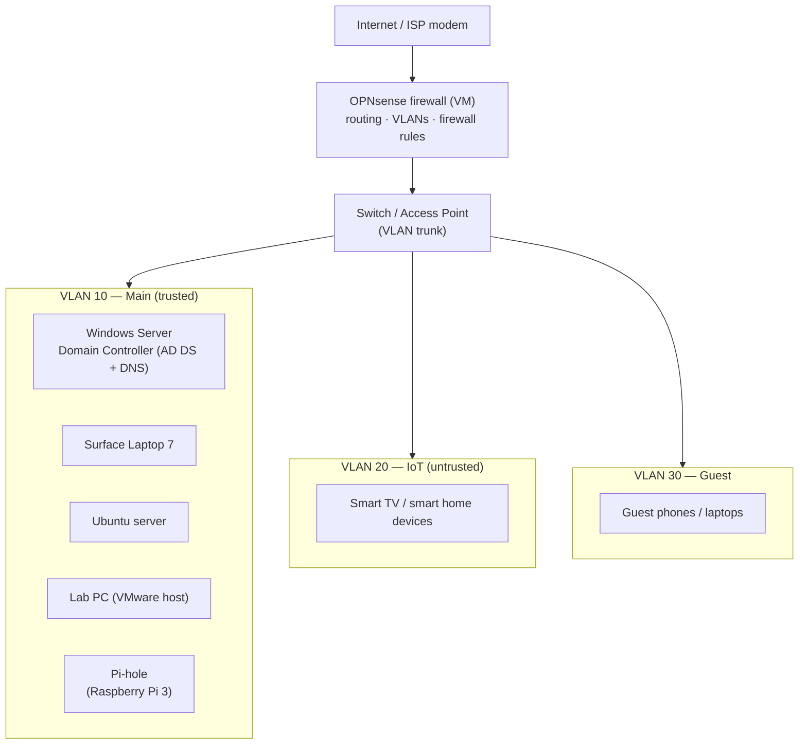

# 🏠 Home Network Lab & Active Directory, Firewall & Segmentation

My home network, built like a small business network: my computers are joined to an **Active Directory domain**, all traffic goes through an **OPNsense firewall**, DNS is filtered by **Pi-hole**, and the network is split into **3 VLANs** so IoT and guest devices can't reach my main machines.

---

## 🗺️ Network Diagram

---

## 🧱 Components

| Component | What it does |
|---|---|
| **OPNsense (VM)** | Router + firewall. Handles VLANs, DHCP, and the rules between subnets |
| **Windows Server (AD DS)** | Domain Controller: central logins, Group Policy, internal DNS |
| **Pi-hole (Raspberry Pi 3)** | DNS filtering: blocks ads, trackers and known-bad domains for the whole network |
| **Domain-joined computers** | Surface Laptop 7 (Windows on ARM), Ubuntu server, Lab PC |
| **VLANs** | Main / IoT / Guest, each on its own subnet |

---

## 🌐 VLAN Plan

| VLAN | Name | Subnet (example) | Who's on it | Can reach |
|---|---|---|---|---|
| 10 | Main | `10.0.10.0/24` | DC, my 3 computers, Pi-hole | Everything |
| 20 | IoT | `10.0.20.0/24` | Smart TV, smart home devices | Internet + Pi-hole DNS only |
| 30 | Guest | `10.0.30.0/24` | Visitors | Internet only |

---

## 🔐 Security Design

- **Segmentation:** a hacked IoT device can't reach my computers or the Domain Controller
- **Default deny:** traffic between VLANs is blocked unless a rule allows it
- **DNS control:** every device uses Pi-hole, and IoT devices are forced to it (they can't use their own DNS)
- **Central identity:** one AD login across my machines, managed with Group Policy
- **Least exposure:** no ports open to the internet
